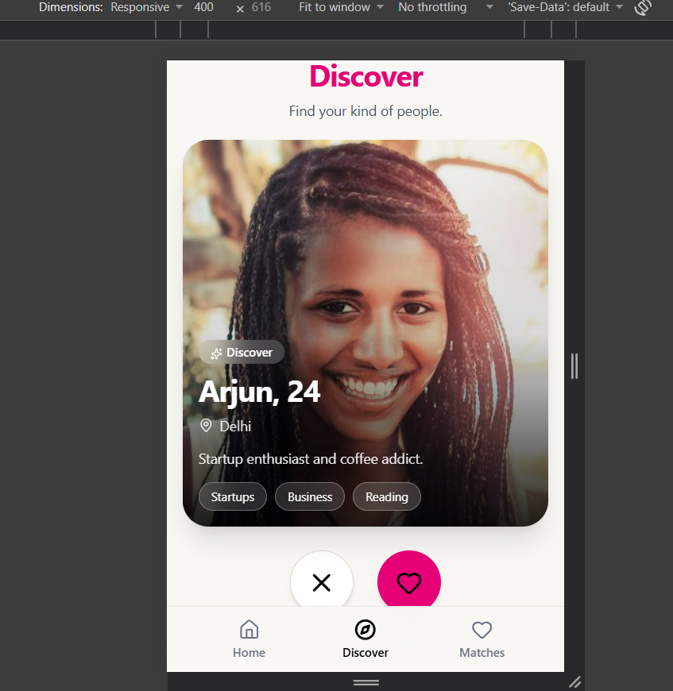
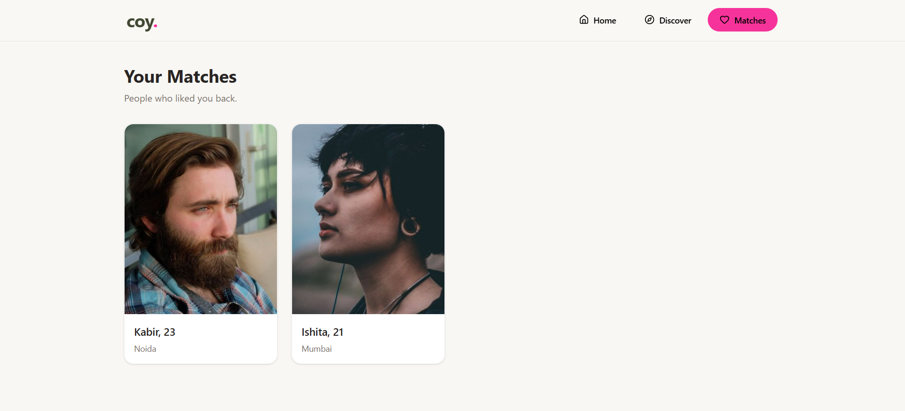
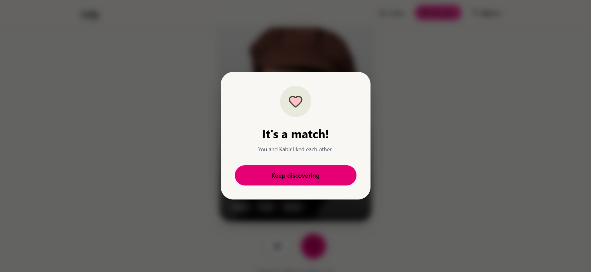
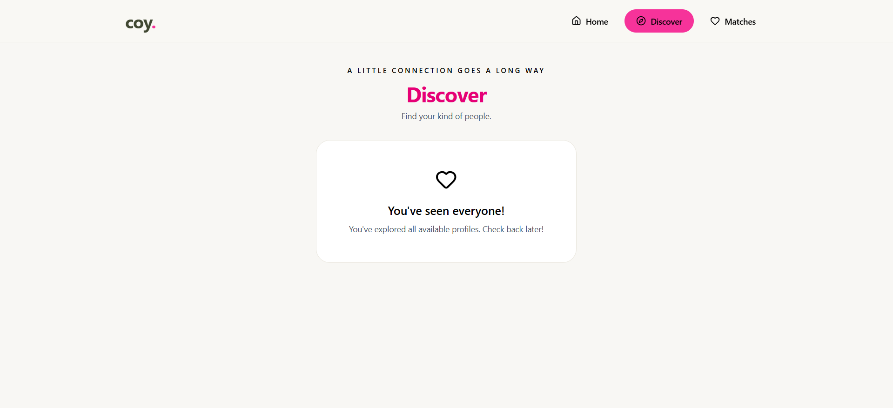
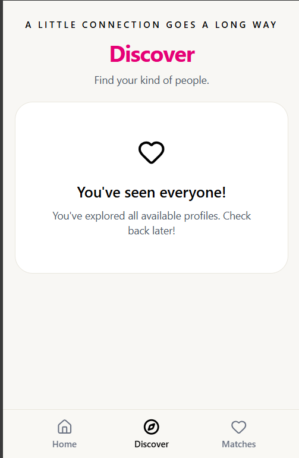

# Coy — Discover & Match

A mobile-friendly, swipe-based discovery application built as part of the Coy SDE Intern assignment.

## Features

- Discover profiles one at a time.
- Like or pass profiles using buttons or swipe gestures.
- Profiles disappear from the feed after being swiped.
- Mutual likes trigger an instant match notification.
- Matches page displays only mutual connections.
- Swipe history and matches persist across refreshes and backend restarts.
- Responsive interface with Home, Discover, and Matches navigation.
- Seeded mock profiles for testing.

## Tech Stack

**Frontend**
- React
- Vite
- Tailwind CSS
- Framer Motion
- Lucide React
- Axios

**Backend**
- Node.js
- Express.js
- JSON file-based persistence

## Project Structure

```text
Coy-assignment/
├── backend/
│   ├── controllers/
│   ├── routes/
│   ├── data/
│   │   ├── profiles.json
│   │   └── swipes.json
│   └── server.js
│
├── frontend/
│   └── src/
│       ├── components/
│       ├── pages/
│       ├── services/
│       └── App.jsx
│
└── README.md
```

## Getting Started

### 1. Clone the repository

```bash
git clone https://github.com/khushigoel0101/Coy-assignment.git
cd Coy-assignment
```

### 2. Start the backend

```bash
cd backend
npm install
node server.js
```

Backend runs at `http://localhost:5000`.

### 3. Start the frontend

Open another terminal:

```bash
cd frontend
npm install
npm run dev
```

Frontend runs at the local URL displayed by Vite, usually `http://localhost:5173`.

## API Endpoints

| Method | Endpoint | Description |
|---|---|---|
| GET | `/api/feed` | Fetch profiles not yet swiped |
| POST | `/api/swipe` | Like or pass a profile |
| GET | `/api/matches` | Fetch mutual matches |

## SCREENSHOTS









### Swipe request example


```json
{
  "profileId": 3,
  "action": "like"
}
```

## Matching Logic

A match is created only when both users have liked each other. Profiles that have not liked the logged-in user are never exposed in the Matches section.

## Persistence

Swipe records are stored in `backend/data/swipes.json`, allowing swipe history and mutual matches to persist across page refreshes and backend restarts.

## Notes

- Uses seeded mock profiles.
- No external authentication is required.
- Designed for a single logged-in user, as specified in the assignment.
